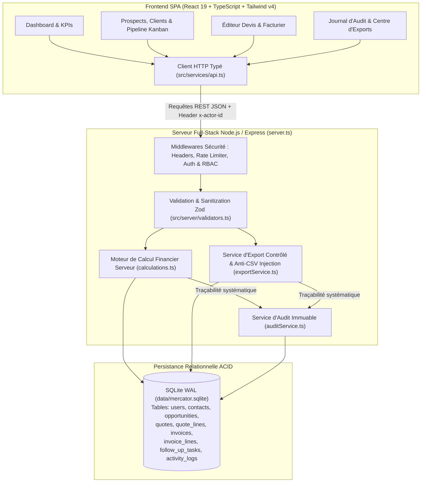
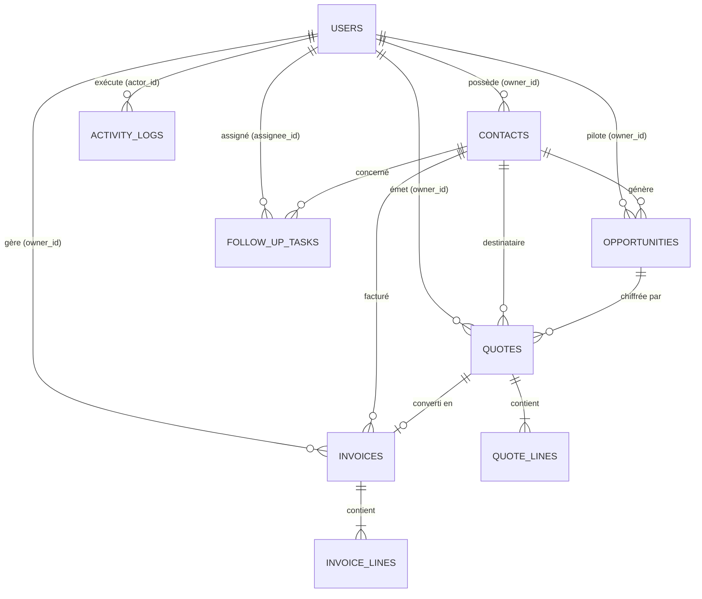

# Architecture Logicielle & Conception — Mercator CRM

Ce document formalise les livrables des **Phases 1 (Discovery)** et **Phase 2 (Conception)** du projet **Mercator CRM — Gestion Commerciale pour PME**.

---

## 1. Reformulation du Besoin, Utilisateurs Cibles & Hypothèses (Phase 1)

### 1.1 Objectif Produit
Fournir aux petites et moyennes entreprises (PME de 5 à 50 collaborateurs) une plateforme centralisée, fiable et auditée couvrant l'intégralité du cycle commercial : de l'acquisition d'un prospect jusqu'à l'encaissement effectif des factures, sans dépendre de feuilles de calcul dispersées où les formules de TVA et de relance sont sujettes aux erreurs humaines.

### 1.2 Personas & Rôles Utilisateurs (RBAC)
1. **Administrateur / Dirigeant (`ADMIN`)** :
   - Pilote la trésorerie facturée, le reste à recouvrer et la performance globale.
   - Dispose de tous les droits de lecture, écriture, suppression contrôlée et export global (y compris le journal d'audit complet).
2. **Directeur / Manager Commercial (`MANAGER`)** :
   - Supervise le pipeline de toute l'équipe, assigne les tâches de relance critiques, valide les devis et enregistre les règlements clients.
   - Peut exporter les données globales mais ne peut pas supprimer définitivement des comptes clients.
3. **Chargé d'Affaires / Commercial (`SALES`)** :
   - Gère son portefeuille de prospects, qualifie ses opportunités, émet ses devis et suit ses relances.
   - **Isolation d'écriture et d'export** : ne peut modifier que ses propres dossiers et ses exports CSV/JSON sont automatiquement filtrés par le serveur sur son seul portefeuille (`OWNED_ONLY`).

### 1.3 Hypothèses Structurantes & Justification de la Stack
- **Justification de l'architecture retenue (`React 19` + `Express 4` + `TypeScript` + `SQLite relationnel WAL via better-sqlite3` + `Zod`)** :
  - La stack indicative mentionnait *Next.js / NestJS / PostgreSQL*. Dans l'environnement d'exécution conteneurisé AI Studio / Cloud Run (port unique 3000, absence de projet GCP de facturation pour provisionner une instance Cloud SQL externe et refus explicite de Firebase par l'utilisateur), une base **SQLite relationnelle embarquée en mode WAL (`better-sqlite3`)** couplée à un serveur **Express TypeScript (`server.ts`)** offre une fidélité relationnelle SQL 100% équivalente (clés étrangères `FOREIGN KEY`, transactions ACID `db.transaction()`, contraintes `CHECK`, index), une latence sub-milliseconde et une autonomie totale sans dépendance externe fragile.
  - La séparation en couches (Présentation React, Contrôleurs REST Express, Services métiers de calcul/audit/export, Persistance SQL) permet une migration transparente vers PostgreSQL si l'entreprise souhaite externaliser sa base de données à terme.

### 1.4 Périmètre MVP Inclus vs Exclusions
- **Inclus dans le MVP** :
  - Gestion complète des **Prospects & Clients** (qualification, coordonnées, TVA intracommunautaire, secteur, propriétaire).
  - **Pipeline d'Opportunités** (vue Kanban 6 colonnes + vue tabulaire, calcul serveur du montant pondéré HT).
  - **Devis commerciaux** (multi-lignes, remises en %, TVA multi-taux 20% / 10% / 5,5% / 0%, prévisualisation serveur en direct, conversion en facture en 1 clic).
  - **Factures & Règlements** (calcul serveur du solde restant dû TTC, gestion des acomptes/paiements partiels, détection automatique des factures échues `OVERDUE`).
  - **Tâches de relance** (appels, suivis de devis, relances d'impayés, alertes de retard).
  - **Dashboard exécutif** (KPIs temps réel, entonnoir pipeline, flux mensuels, relances urgentes).
  - **Historique d'activité (Journal d'audit immuable)** et **Centre d'Exports contrôlés (CSV/JSON)**.
- **Exclusions explicites (Roadmap v2)** :
  - Prélèvement bancaire SEPA direct via API bancaire (DSP2 / Open Banking).
  - Signature électronique qualifiée eIDAS via prestataire tiers (DocuSign / Yousign).
  - Envoi SMTP transactionnel direct (nécessite la configuration d'un relais SMTP d'entreprise).

---

## 2. Architecture Système & Flux de Données (Phase 2)

### 2.1 Diagramme d'Architecture (Mermaid)

### 2.2 Modèle Relationnel des Données (ERD)

---

## 3. Matrice des Permissions (RBAC)

| Opération / Ressource | `ADMIN` (Dirigeant) | `MANAGER` (Directeur Comm.) | `SALES` (Commercial) |
| :--- | :---: | :---: | :---: |
| Lecture Dashboard, Contacts, Pipeline, Devis, Factures | Global | Global | Global (Lecture partagée) |
| Création Prospect, Opportunité, Devis, Relance | Autorisé | Autorisé | Autorisé |
| Modification Contact / Opportunité / Devis / Tâche | Global | Global | **Uniquement ses propres dossiers (`owner_id = actor.id`)** |
| Conversion Devis → Facture & Saisie Règlement | Global | Global | **Uniquement ses propres dossiers** |
| Suppression définitive d'une fiche Contact (sans facture) | **Autorisé** | Refusé (`403`) | Refusé (`403`) |
| Export CSV / JSON (Contacts, Pipeline, Devis, Factures) | Global (`GLOBAL`) | Global (`GLOBAL`) | **Restreint à son portefeuille (`OWNED_ONLY`)** |
| Export CSV / JSON du Journal d'Audit complet (`activities`) | **Autorisé** | **Autorisé** | Refusé (`403 FORBIDDEN_EXPORT`) |

---

## 4. Contrats API Principaux (`/api/*`)

| Méthode & Route | Description | Validation & Règles Serveur |
| :--- | :--- | :--- |
| `GET /api/health` | État de santé du service | Public, aucune donnée sensible exposée |
| `GET /api/users` | Liste des utilisateurs actifs et profil courant | Authentifié via `x-actor-id` |
| `GET /api/dashboard` | Agrégations KPIs, entonnoir pipeline, CA mensuel, relances | Calculé intégralement côté serveur |
| `GET /api/contacts` | Liste filtrée des prospects et clients (`status`, `search`) | Paramètres SQL préparés |
| `POST /api/contacts` | Création d'un prospect ou client | Validation `contactInputSchema` + Audit `CONTACT_CREATED` |
| `PUT /api/contacts/:id` | Mise à jour d'un prospect ou client | Vérification RBAC propriétaire + Audit |
| `DELETE /api/contacts/:id` | Suppression d'un contact sans facture liée | Réservé `ADMIN` (`requireRoles(Role.ADMIN)`) + Audit |
| `GET /api/opportunities` | Liste des opportunités du pipeline | Tri par date de clôture |
| `POST /api/opportunities` | Création d'une opportunité | Calcul serveur `weightedAmountHt` + Audit |
| `PATCH /api/opportunities/:id/stage` | Changement d'étape Kanban | Recalcul serveur probabilité (WON=100%, LOST=0%) + Promotion client actif |
| `POST /api/calculations/preview` | Simulation de calcul de lignes HT/Remise/TVA/TTC | Utilise `calculateDocumentTotals` côté serveur |
| `GET /api/quotes` | Liste des devis avec leurs lignes détaillées | Jointure `quote_lines` |
| `POST /api/quotes` | Émission d'un nouveau devis | **Ignore tout total client**, recalcule chaque ligne côté serveur + Audit |
| `POST /api/quotes/:id/convert-to-invoice` | Conversion atomique Devis → Facture | Transaction SQLite : crée facture + lignes, passe devis `ACCEPTED`, opportunité `WON` |
| `GET /api/invoices` | Liste des factures avec calcul d'échéance temps réel | Recalcule `balanceDue` et statut `OVERDUE` côté serveur |
| `POST /api/invoices/:id/payments` | Enregistrement d'un règlement partiel ou total | Recalcule `balanceDue` et statut (`PARTIALLY_PAID` / `PAID`) + Audit |
| `GET /api/tasks` & `POST /api/tasks` | Liste et planification des tâches de relance | Détection serveur des retards (`isOverdue`) + Audit |
| `PATCH /api/tasks/:id/status` | Clôture ou changement d'état d'une relance | Vérification RBAC assigné + Audit |
| `GET /api/activities` | Consultation du journal d'audit immuable | Filtrable par `entityType` |
| `GET /api/export` | Export contrôlé (`entity`, `format=csv\|json`) | Rate-limit dédié, RBAC, neutralisation CSV Formula Injection, trace d'audit |

---

## 5. Analyse des Risques (Sécurité, Confidentialité, Coûts, Dépendances)

1. **Manipulations financières côté client (Risque Critique)** :
   - *Mitigation* : Le serveur (`src/server/services/calculations.ts`) recalcule systématiquement les montants bruts, remises, taxes et soldes à partir des quantités et prix unitaires validés par Zod. Tout champ `totalTtc` ou `netHt` envoyé dans le corps d'une requête `POST /api/quotes` est ignoré.
2. **Injection de formules malveillantes dans les exports CSV (OWASP CSV Injection)** :
   - *Mitigation* : `sanitizeCsvCell` préfixe d'une apostrophe (`'`) toute cellule commençant par `=`, `+`, `-`, `@`, `\t` ou `\r` avant génération du fichier CSV.
3. **Exfiltration massive de données commerciales** :
   - *Mitigation* : Un rate-limiter spécifique (`createRateLimiter('export')`) limite les requêtes d'export, le rôle `SALES` est confiné à ses propres enregistrements (`OWNED_ONLY`), l'export du journal d'audit lui est interdit (`403`), et chaque export réussi ou refusé est consigné dans `activity_logs`.
4. **Confidentialité & RGPD** :
   - *Mitigation* : Aucune donnée personnelle réelle n'est présente dans le dépôt. Le jeu d'essai utilise des domaines fictifs (`*-example.fr`, `@mercator-demo.fr`).
